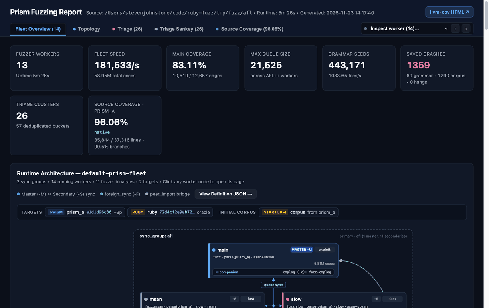

# prism-fuzzer

A self-contained fuzzing orchestration framework built primarily to fuzz [Prism](https://github.com/ruby/prism) (using CRuby's `parse.y` as a differential oracle). Define multi-fuzzer campaigns in a local Ruby DSL, execute state-of-the-art coverage-guided and differential fuzzers inside an all-in-one Docker toolchain, and automatically deduplicate, cluster, bisect, and inspect crashes alongside detailed interactive performance and LLVM coverage reports.


---

## Bug Classes Detected

- **Memory safety issues**: Heap/stack buffer overflows, use-after-free, null dereferences, integer/shift undefined behavior, and uninitialized reads detected via **ASan**, **UBSan**, and **MSan** (`fuzz`, `fuzz.msan`), strict bounded/size-checked allocations under `PM_XALLOCATOR` (`fuzz_malloc`, `fuzz_free_sized`, `fuzz_realloc_sized` in [`harnesses/prism/fuzz.c`](harnesses/prism/fuzz.c)), and 32-bit alignment/endianness faults on `arm32` and `ppc` under QEMU (`fuzz.arm32`, `fuzz.ppc`).
- **Memory leaks**: Per-input heap leak checks via **LeakSanitizer** (`fuzz.lsan`) and exact `PM_XALLOCATOR` allocation-balance assertions (`allocated == 0` after every parse in [`harnesses/prism/fuzz.c`](harnesses/prism/fuzz.c)), with LSan disabled on embedded-CRuby [`fuzz.diff`](harnesses/prism/diff.c) where CRuby intentionally retains VM allocations across parses.
- **AST structural & parser invariant violations**: Exhaustive post-parse validation in [`harnesses/prism/parse.c`](harnesses/prism/parse.c) and [`harnesses/prism/include/fuzz_invariants.h`](harnesses/prism/include/fuzz_invariants.h), catching:
  - Out-of-bounds or underflowing/overflowing node and sub-location byte spans (`start_underflow`, `length_underflow`, `end_overflow`, `start_oob`, `end_oob`);
  - Sibling ordering/overlap and parent–child containment bugs (`sibling_overlap`, `duplicate_part`, `start_after_child`, `child_oob`, `child_before_opening`, `child_after_closing`);
  - Unsorted comments, invalid diagnostics/magic comments, non-monotonic `line_offsets`, recursion depth exceeding `PRISM_DEPTH_MAXIMUM` without a `nesting_too_deep`/`stack_exhausted` error, and `PM_ERROR_RECOVERY_NODE` emitted with zero parser errors;
  - Streaming (`pm_parse_stream`) vs. full-buffer (`pm_parse`) parse parity (`stream_diff`) and 32-bit vs. 64-bit serialized AST parity (`oracle_arm32` / `oracle_ppc` in [`harnesses/prism/parse32.c`](harnesses/prism/parse32.c)).
- **Divergences between Prism and CRuby's `parse.y`**: Differential oracle checks in [`harnesses/prism/diff.c`](harnesses/prism/diff.c) and [`harnesses/prism/diff/summary.c`](harnesses/prism/diff/summary.c) catching `syntax_mismatch`, lexical scope variable mismatches (`locals_count_mismatch`, `locals_name_mismatch`), structural AST/def/block-owner divergences (`ast_tree_mismatch`, `ast_scope_kind_mismatch`, `ast_scope_count_mismatch`, `ast_node_count_mismatch`, `ast_def_name_mismatch`, `ast_block_owner_mismatch`), and `eval`/ISeq discrepancies — plus two-version A/B Prism-vs-Prism regressions (`diff_prism` in [`harnesses/prism/prism_diff.c`](harnesses/prism/prism_diff.c)).

---

## Core Highlights

### 1. Design Fuzzing Topologies Locally in a Ruby DSL

Instead of wrangling fragile shell loops or Compose files, you describe an entire fuzzing fleet as an executable Ruby script (`campaigns/*.rb`, [`examples/`](examples/README.md)) powered by [`lib/prism_fuzzer.rb`](lib/prism_fuzzer.rb) and [`runtime/campaign_dsl.rb`](runtime/campaign_dsl.rb).

```ruby
#!/usr/bin/env ruby
require "prism_fuzzer"

PrismFuzzer.campaign "prism-hybrid-fleet" do
  workspace "tmp/runs/pr-check"
  duration "2h"
  after_run { report threads: 4, top: 25; publish run_id: "pr-check" }

  prism :prism_a, repo: PrismFuzzer::CampaignDSL::PRISM_DEFAULT_REPO, ref: "main", patches: "auto"
  ruby  :ruby,    repo: PrismFuzzer::CampaignDSL::RUBY_DEFAULT_REPO,  ref: ENV.fetch("RUBY_REF", "495f3778")

  coverage source: :prism_a, fuzzer: "fuzz", diff_fuzzer: "fuzz.diff"

  grammar_generator :grammar, source: :prism_a, fuzzer: "fuzz", sync_group: :afl, seeds_dir: "/tmp/afl-tmpdir/grammar/seeds", schedule: "lrama"

  fuzzer "fuzz",      shape: :prism_parse,     source: :prism_a, sanitizers: %i[asan ubsan], mode: :fast, afl: :lto, document_ids: true
  fuzzer "fuzz.ijon", shape: :prism_parse,     source: :prism_a, sanitizers: [],           mode: :fast, afl: :lto, ijon: true, xallocator: true
  fuzzer "fuzz.diff", shape: :prism_diff_ruby, prism: :prism_a,  ruby: :ruby, sanitizers: [],           afl: :pcguard, document_ids: true

  sync_group :afl,         dir: "afl", primary: true
  sync_group :ijon_island, dir: "afl-ijon"

  worker :grammar, kind: :generator, generator: :grammar
  worker :main, fuzzer: "fuzz", sync_group: :afl, afl_role: :main, schedule: "exploit" do
    peer_import group: :ijon_island, worker: :ijon, alias: "ijon_peer"
  end
  worker :ijon, fuzzer: "fuzz.ijon", sync_group: :ijon_island, afl_role: :main, schedule: "explore", foreign_sync: [:grammar]
  worker :diff, fuzzer: "fuzz.diff", sync_group: :afl, afl_role: :secondary, schedule: "coe"
end
```

- **Isolated workspaces & zero runtime `make`**: Each campaign compiles to a Draft 2020-12 schema-validated Topology IR ([`topology.schema.json`](topology.schema.json)), keeping `<ws>/build/`, `<ws>/bin/`, corpora, logs, and `<ws>/report/` isolated per run while sharing `.cache/repos/` git mirrors and compiled AFL++ passes.
- **Declarative CLI & Imperative Ruby API**: Run scripts directly (`./my_campaign.rb run`, `attach`, `logs`, `stats`, `stop`) or pass `autorun: false` to orchestrate stages programmatically via `PrismFuzzer::Campaign::Instance` (`validate!`, `sync!`, `build!`, `start!`, `wait!`, `report!`).
- **Composable multi-island routing**: Model fast unsanitized exploration islands, sanitized verification hubs, AFL++ `Sand` (`aux_fuzzer`), asymmetric `peer_import` sync bridges, `#define` compiler flag matrices, or two-version A/B differential campaigns. See [`examples/`](examples/README.md) for six ready-to-run topologies.

### 2. State-of-the-Art Fuzzing Machinery

Built on **AFL++ v5.03c** and **LLVM 20**, `prism-fuzzer` combines modern greybox, grammar, and differential techniques across [`harnesses/prism/`](harnesses/prism/) and [`patches/afl/`](patches/afl/):

- **Sanitizer-free AFL++ coverage patch ([`aflplusplus.patch`](patches/afl/aflplusplus.patch))**: Patches `SanitizerCoverageLTO.so` and `SanitizerCoveragePCGUARD.so` to strip compiler-inserted ASan/UBSan/MSan runtime checks, MSan shadow `select`/`icmp` propagation, and `assert()` traps from the coverage CFG—eliminating 40–130% bitmap inflation without disabling runtime sanitizer traps.
- **LTO, CmpLog (Redqueen), IJON & Sand**: Combines link-time instrumentation (`afl: :lto`), CmpLog comparison solving (`fuzz.cmplog`), custom AFL++ IJON state feedback (`fuzz.ijon`) paired with `PM_XALLOCATOR`, AFL++ Sand (`fuzz.sand`), and diverse mutation schedules (`exploit`, `explore`, `coe`, `lin`, `fast`, `-L 0`, `-Z`).
- **Live grammar synthesis with [`lrama-fuzz`](https://github.com/kddnewton/lrama-fuzz) ([`runtime/grammar.rb`](runtime/grammar.rb))**: Derives Ruby programs directly from CRuby's `parse.y` LALR(1) grammar, evolves them against Prism's C extension (`fuzz-ruby-ext`), and feeds expanded AST, regexp, encoding, comment, and heredoc seeds into AFL++ via foreign sync (`-F`).
- **Multi-oracle differential fuzzing**:
  - **Prism vs. CRuby `parse.y` oracle (`fuzz.diff`)**: Compares Prism against CRuby's `parse.y` oracle across syntax validity, AST structure, scope locals, and bytecode/eval behavior.
  - **Prism A vs. Prism B (`fuzz.prism_diff`)**: Links two arbitrary Prism commits into one binary with `objcopy --redefine-syms` symbol isolation and per-side PCGUARD domain coverage IDs (`AFL_LLVM_DOCUMENT_IDS`).
  - **32-bit cross-arch endianness & alignment (`fuzz.arm32`, `fuzz.ppc`)**: Executes 32-bit ARM and PowerPC harnesses under QEMU user-mode emulation, comparing 32-bit vs. 64-bit serialized AST parity via custom mutator `mutator_oracle64.so` alongside [`0001-arena-32bit-alignment.patch`](patches/prism/0001-arena-32bit-alignment.patch).
  - **Deep parser invariants & SIMD checks**: Exercises `fuzz.slow` (`pm_serialize`, `pm_serialize_parse_stream`, `pm_errors_format`), post-parse AST/sub-location/span/stream-vs-buffer invariants (`fuzz_invariants.h`), and SIMD-vs-SWAR scanner differential fuzzing (`test/test_accel.sh`).

### 3. Zero-Setup Toolchain Completely Inside Docker

Your local machine only needs Ruby and Docker. Every heavy build, cross-compilation, and execution dependency lives inside the [`prism-fuzzer` image](docker/Dockerfile):

- Preconfigured **AFL++ v5.03c**, **LLVM 20**, **Clang**, **GCC cross-toolchains + QEMU (`armhf` & `powerpc`)**, patched **GLib / `halfempty`**, pinned **CRuby static oracle (`/opt/ruby`)**, `xxhash`, and `tmux`.
- Arbitrary upstream git SHAs or local checkouts are synced into `.cache/repos/` and checked out cleanly without host-specific git `alternates` paths, then bind-mounted seamlessly into `/prism-fuzzer`.
- Interactive TTY launches render live BuildKit-style scrolling stage boxes (`Sync`, `Build`, `Run`, `Report`) while teeing every step and per-worker `tmux` pane to persistent logs under `<ws>/logs/`.

### 4. Automatic Crash Triage, Clustering, Explanation & Bisection

Raw crashes are automatically processed into actionable root-cause groups by the pipeline under [`triage/`](triage/triage.md):

- **Normalization & parallel minimization ([`triage/triage.rb`](triage/triage.rb), [`signature.sh`](triage/signature.sh), `halfempty`)**: Deduplicates crashes via normalized trace and `INVARIANT[...]` 64-bit xxHash signatures, minimizes inputs alongside 4-byte option headers, archives unique inputs (`inputs.tar.gz`), and emits standalone `verify.sh` wrappers.
- **Metadata-only root-cause clustering ([`triage/cluster.rb`](triage/cluster.rb), [`clustering.md`](triage/clustering.md))**: Runs UPGMA agglomerative clustering using Weighted Jaccard similarity over Laplace-smoothed corpus-IDF `afl-showmap` edge coverage, leaf-anchored Prism call frames, and a soft crash-reason prior—unifying crashes from the same bug even when triggered across ASan, MSan, UBSan, and invariant `ABRT` builds.
- **Fast C99 batch verification ([`verify_runner.c`](triage/verify_runner.c), [`verify.rb`](triage/verify.rb))**: Re-verifies thousands of archived raw inputs quickly under `fork()` + shared `mmap` isolation, tracks `FAIL` / `PARTIAL` / `PASS` lifecycles, extracts surviving inputs, and refreshes crops after fixes ([`retriage.rb`](triage/retriage.rb)).
- **Interactive diagnostics & automated `git bisect`**:
  - [`inspect.rb`](triage/inspect.rb): Lists clusters, AST anomalies, ISeq/syntax diffs, stack traces, non-default options, and `--since` snapshot regressions.
  - [`explain.rb`](triage/explain.rb) + [`explain.c`](harnesses/prism/explain.c): Renders inline AST anomaly callouts, buffer-vs-stream serialization diffs, Dockerized CRuby `parse.y` bytecode disassembly & `--eval` comparisons, side-by-side `prism_a` vs. `prism_b` diffs, and 32-bit `qemu-arm`/`qemu-ppc` comparisons.
  - [`match.rb`](triage/match.rb) & [`bisect.rb`](triage/bisect.rb): Probes candidate snippets against existing clusters and runs automated `git bisect` across Prism commit history using isolated git worktrees.

### 5. Detailed Interactive Performance, Lineage & Coverage Reports

Running `report` (or setting `after_run { report ... }`) compiles a self-contained HTML bundle at `<ws>/report/index.html` via [`report/report.rb`](report/report.rb):



- **Fleet Overview & Topology Visualization**: Interactive SVG fleet topology diagram, worker KPI summary (uptime, fleet execs/s, bitmap edge coverage %, saved crashes/hangs, triage clusters, LLVM line/region/branch coverage), and per-worker summary metrics.
- **Time-Series SVG Charts & Sync Yield**: Plots edge coverage %, edges discovered, corpus growth, throughput (`execs/sec`), cumulative executions, pending favored queue, foreign synced imports, locally discovered items, grammar seed creation/import rates, and peer-sync import/reject/skip yield bars across workers.
- **Crash Lineage & Interactive Triage Sankey ([`report/sankey.rb`](report/sankey.rb))**: Tracks crash provenance (grammar seeds vs. initial corpus vs. local mutations vs. synced peers) and visualizes fuzzer/origin → crash reason → root-cause cluster → signature bucket flows.
- **LLVM Source Coverage ([`report/coverage.sh`](report/coverage.sh))**: Writes `<ws>/report/index.html` immediately after triage so fleet and triage tabs are usable right away, then streams progressive per-pair coverage summaries and `llvm-cov` HTML links into open `file://` or `https://` tabs via `coverage/coverage.js` (with incremental `(last_cutoff, cutoff]` `.profdata` caching across mid-run snapshots; see [`docs/architecture.md`](docs/architecture.md#3-decoupled-reporting--incremental-per-pair-llvm-coverage-reportreportrb--reportcoveragesh)).
- **Searchable Triage Explorer & GitHub Pages Publishing ([`bin/publish.rb`](bin/publish.rb))**: Filter buckets, view minimized reproducers, inspect normalized stack traces, open one-click Prism Loupe browser links, and archive complete multi-run report snapshots (including `llvm-cov` HTML and `triage/` bucket artifacts) into a gitignored `reports/` `gh-pages` branch worktree.

---

## Grammar-Based Seed Synthesis (`lrama-fuzz`)

Coverage-guided byte mutators alone struggle to synthesize deeply nested Ruby syntax, heredocs, encodings, or complex Onigmo regexps from scratch. To continuously feed structurally rich inputs into the AFL++ fleet, [`runtime/grammar.rb`](runtime/grammar.rb) pairs the [`lrama-fuzz`](https://github.com/kddnewton/lrama-fuzz) grammar fuzzer (built on [`lrama`](https://github.com/ruby/lrama)) with target-specific mutation and Prism parser feedback:

1. **Parsing CRuby's real grammar (`parse.y`)**: At startup, `Lrama::Fuzz.parse_ruby` parses `/opt/ruby/parse.y` and `/opt/ruby/defs/id.def` (or `$RUBY_SRC_DIR`) once in the supervisor process before `fork`, letting worker processes share the prepared LALR(1) `Lrama::Grammar` copy-on-write.
2. **Dual evolutionary generators**: Each 50-generation epoch alternates two `lrama-fuzz` evolvers:
   - **`ComposedEvolver` (`PrismComposer < Lrama::Fuzz::Ruby::Composer`)**: Generates variable-scoped Ruby programs enriched with Onigmo named-capture/property regexps (`MatchWriteNode`), static-literal hash key collisions (bignums, rationals, imaginaries, floats, `__LINE__`), and structural comment/embdoc blocks (`src/comments.c`).
   - **`GuidedGrammarEvolver` (`Lrama::Fuzz::Evolver` + `Lrama::Fuzz::Generator`)**: Evolves codon genomes directly over `parse.y` rules with coverage-guided rule selection (prioritizing uncovered rules and rules not yet seen in valid programs) while permitting controlled invalid terminals (`allow_invalid: true`) to stress Prism error recovery.
3. **Context-aware terminals & post-generation variants**: `build_ruby_terminals` tracks a delimiter stack (`tSTRING_BEG`, `tREGEXP_BEG`, `%w`/`%W`/`%i`/`%I` word lists) alongside large Karatsuba/schoolbook bignums and boundary floats. Candidates are expanded (`expand_candidate_variants`) with `pm_options_t` 4-byte harness option headers (`OPTION_SEED_HEADERS`), single/nested heredoc rewrites (`inject_heredocs`), multibyte encoding/regexp probes (`inject_encoding_variant`), and magic/shebang/`=begin` comments (`inject_comments_variant`).
4. **Prism fitness scoring & crash capture**: Candidates are scored in-process against the compiled target C extension (`fuzz-ruby-ext`, via `Prism.parse` and `Prism.parse_success?`) after writing an `in_flight` breadcrumb; if a generated input crashes the worker itself, the supervisor archives it to `<afl_dir>/<worker>/crashes/`, forwards it into AFL++ for ASan/UBSan triage, and respawns the worker.
5. **AFL++ foreign sync & backpressure**: Seeds are deduplicated by SHA-1 digest, written atomically into the generator's `seeds_dir`, pushed to the configured `foreign_sync` consumer (`-F`) via `SIGUSR2`, and pruned once AFL++ reads them (benchmarkable locally via `./campaigns/default.rb bench` / [`runtime/grammar_bench.rb`](runtime/grammar_bench.rb)).

---

## Quick Start

```bash
# 1. Build the Docker fuzzing toolchain image (AFL++ v5.03c, LLVM 20, QEMU arm32/ppc, CRuby)
./campaigns/default.rb docker-build

# 2. Sync targets, build fuzzers, start the fleet, and auto-run triage, coverage & report on exit
./campaigns/default.rb                        # or: ./campaigns/default.rb run --duration 2h (--no-post skips report)

# 3. Detached mode & observing live containers directly from the campaign script
./campaigns/default.rb run -d                 # prints container name along with attach/status/logs/stop commands
./campaigns/default.rb attach                 # attaches to this campaign's tmux container (knows its own workspace/container)
./campaigns/default.rb ps                     # list running containers + campaign/workspace labels + attach commands
./campaigns/default.rb logs [step|worker ID]  # tail live container logs or inspect <ws>/logs/{sync,build,run,triage,...}.log
./campaigns/default.rb stats                  # print workspace AFL++, triage, and coverage stats
./campaigns/default.rb stop
```

External campaign scripts (`~/my_campaign.rb`) can require [`lib/prism_fuzzer.rb`](lib/prism_fuzzer.rb) directly (or via `RUBYLIB=/path/to/prism-fuzzer/lib`) and support the same subcommands (`./my_campaign.rb run`, `./my_campaign.rb report`, etc.).

### Targeting Specific Versions & Differential Prism-vs-Prism Campaigns

```bash
# Fuzz a specific Prism revision against CRuby:
PRISM_REF=v1.9.0 ./campaigns/default.rb build

# Differential fuzz two Prism commits (e.g. baseline vs optimization branch):
PRISM_REF=main PRISM_B_REF=my-opt-branch ./campaigns/default.rb run

# Point directly at local checkouts without cloning:
PRISM_DIR=/path/to/prism-a PRISM_B_DIR=/path/to/prism-b ./campaigns/default.rb build

# Override the CRuby oracle commit (builds incrementally into <ws>/build/targets/ruby/ if != /opt/ruby):
RUBY_REF=v3_4_1 ./campaigns/default.rb build --build-ruby
```

### Reporting, Triage Investigation, Cleanup & Tests

```bash
./campaigns/default.rb report                          # Triage crashes, write <ws>/report/index.html immediately, then collect LLVM coverage (--no-coverage skips)
./campaigns/default.rb coverage                        # Collect LLVM coverage independently into <ws>/report/coverage/ (hydrates existing index.html)
./campaigns/default.rb inspect -- --samples 1          # Inspect triaged clusters in <ws>/report/triage/
./campaigns/default.rb explain -- --cluster cluster-01 # Or add -- --disasm --all-buckets
./campaigns/default.rb verify -- --target /path/to/fixed-prism
./campaigns/default.rb bisect -- --good <sha> --bad HEAD --cluster cluster-01
./campaigns/default.rb publish -- --run-id camp-01 --commit --push # Snapshot all report/coverage/triage artifacts to the gh-pages worktree (`reports/`) and push
./campaigns/default.rb clean                           # Remove runtime dirs under <ws>/ while keeping report/triage/ and build/
make lint                                              # Run ShellCheck, Ruby/AST/RuboCop checks, coding standards & topology validation
make hooks                                             # Enable the tracked .githooks/pre-commit hook (`SKIP_LINT=1` bypasses once)
make test                                              # Run dependency-tracked test stages in parallel inside Docker
make test TEST_FORCE=1                                 # Re-run all test assertions while reusing cached .o/binary artifacts
make test-triage-cluster                               # Run an individual test stage (`test-targets-<stage>` / `ruby test/run.rb --list`; `test-clean` clears `build/test/`)
```

---

## Campaign CLI & Environment Reference

Any executable campaign script (`./campaigns/default.rb`, any [`examples/*.rb`](examples/README.md), custom scripts importing [`lib/prism_fuzzer.rb`](lib/prism_fuzzer.rb), or `./bin/campaign.rb <subcmd> [campaign.rb]`) supports:

- **Lifecycle & container control**: `run` *(default)*, `attach`, `stop`, `ps`, `status`, `stats`, `logs [step | worker <id>]`, `shell`, `bench`, `accel`, `clean`.
- **Targets, validation & build**: `validate`, `compile`, `plan`, `paths`, `sync`, `sync-ruby`, `build`, `docker-build`, `env`, `docker-args`, `plan-launch`.
- **Report & investigation**: `report`, `coverage`, `retriage`, `verify`, `bisect`, `match`, `inspect`, `explain`, `publish` (forward tool-specific flags after `--`).

Common CLI flags:

| Option | Purpose |
| :--- | :--- |
| `-c`, `--campaign PATH` | Override campaign `.rb` or compiled IR `.json` (also `--topology PATH`) |
| `--fuzz-dir`, `--build-dir`, `--corpus-dir`, `--bin-dir`, `--cache-dir PATH` | Override workspace runtime, build, corpus, snapshot bin, or git mirror cache directory |
| `--container-name NAME` | Override deterministic Docker container name |
| `--duration SPEC` | Set/override campaign timer (e.g. `30m`, `2h`, `300`; `0` clears DSL timer) |
| `-d`, `--detach` | Launch fuzzers in background and print Docker attach/status/stop commands |
| `--post` / `--no-post` | Enable `report` (triage + coverage + HTML report) after fuzzing stops, or disable all `after_run` steps |
| `--report`, `--no-coverage`, `--publish` | Enable post-run `report`, skip LLVM coverage during `report`, or enable `publish` |
| `--run-id ID`, `--title TEXT`, `--out-dir DIR` | Override `publish` snapshot metadata and destination |
| `--skip-sync`, `--skip-build`, `--build-ruby`, `--force` | Skip sync or binary rebuild; compile non-default `RUBY_REF`; force Docker rebuild (`docker-build`) |
| `--live` | Query live container status on `stats` |
| `-f`/`--follow`, `-n`/`--tail LINES`, `--raw` | Stream logs, set trailing line count, or keep ANSI sequences on `logs` |
| `--progress MODE` | Terminal stage UI mode: `auto` (default BuildKit box on TTY), `tty`, or `plain` |
| `--relative`, `--json`, `--dry-run`, `-h`/`--help` | Emit relative `paths`, JSON output, print commands without running, or show CLI help |

Relevant environment overrides: `CAMPAIGN`, `PRISM_REF`/`PRISM_REPO`/`PRISM_DIR`/`PRISM_PATCHES`/`PRISM_TEMPLATES`, `PRISM_B_*`, `RUBY_REF`/`RUBY_REPO`/`RUBY_DIR`, `TARGETS_OFFLINE=1`, `FUZZ_DIR`, `FUZZ_BUILD_DIR`, `FUZZ_LOGS_DIR`, `FUZZ_CONTAINER_NAME`, `FUZZ_DOCKER_IMAGE`, `FUZZ_MAX_INPUT_SIZE`, `FUZZ_MAX_ALLOCATED`, `FUZZ_FLAGS`, `FUZZ_PROGRESS`, `FUZZ_PROGRESS_LINES`, `FUZZ_COVERAGE_NO_CACHE=1`, `FUZZ_COVERAGE_FINAL=0|1`, and `FUZZ_SKIP_COVERAGE=1`.

---

## Directory Layout

```
.
├── .githooks
│   └── pre-commit                  staged pre-commit hook running ShellCheck, Ruby/AST/RuboCop, and topology checks
├── Makefile                        wrapper targets for Docker, build, run, triage, lint, hooks, and tests
├── bin
│   ├── campaign.rb                 CLI dispatcher for campaign scripts
│   ├── lint.rb                     shared static-analysis runner used by `make lint`, pre-commit, and CI
│   ├── publish.rb                  packages report, coverage HTML, and triage artifacts into the gh-pages worktree (`reports/`)
│   └── topology.rb                 CLI for validating, syncing, building, and planning topologies
├── campaigns
│   ├── default.rb                  default executable multi-fuzzer campaign script
│   ├── ijon.rb                     IJON-centric fleet campaign (sanitized, slow, MSan, and parse.y IJON hub)
│   └── ijon-small.rb               256-byte IJON-centric fleet variant (`tmp/fuzz-ijon-small`, `-G 260`)
├── dict
│   └── prism.dict                  AFL++ / libFuzzer Ruby syntax & keyword dictionary
├── docker
│   └── Dockerfile                  image with AFL++ v5.03c, LLVM 20, QEMU arm32/ppc, CRuby, halfempty
├── docs
│   ├── architecture.md             detailed design notes for DSL, Prism-vs-Prism diff, and reporting
│   ├── demo.gif                    terminal recording of live fleet launch and triage
│   ├── fuzz_triage_cheatsheet.md   quick reference for inspect, explain, verify, match, and bisect
│   └── report_demo.gif             interactive HTML report tour GIF
├── examples                        curated example campaign topologies (01_ab_pr_diff.rb .. 06_imperative_orchestrator.rb)
├── harnesses
│   └── prism
│       ├── accel.c                 SIMD vs. SWAR scanner differential test harness
│       ├── diff.c                  Prism vs. CRuby parse.y differential oracle harness
│       ├── explain.c               diagnostics helper for inline AST, stream, and ISeq diffs
│       ├── fuzz.c                  AFL++ / libFuzzer persistent entrypoint and PM_XALLOCATOR
│       ├── include                 invariant & option headers (fuzz_invariants.h, fuzz_options.h, prism_ijon.h)
│       ├── mutator_oracle64.c      custom AFL++ mutator attaching 64-bit serialized AST oracles
│       ├── parse.c                 parser, serializer, stream-vs-buffer, and AST invariant checks
│       ├── parse32.c               32-bit cross-arch alignment & endianness differential harness
│       └── prism_diff.c            two-version Prism A vs. Prism B differential harness
├── lib
│   ├── prism_fuzzer.rb             require entrypoint for external Ruby campaign scripts
│   └── ruby_fuzz.rb                backwards-compatibility alias for PrismFuzzer
├── oss-fuzz                        OSS-Fuzz integration (Dockerfile, build.sh, project.yaml, *.options)
├── patches
│   ├── afl                         SanitizerCoverage patches removing sanitizer edge inflation & PPC fixes
│   └── prism                       minimal fuzzing patches applied to synced Prism checkouts
├── report
│   ├── coverage.sh                 collects deduplicated corpus llvm-cov HTML, JSON, and LCOV data
│   ├── lib                         HTML report views, SVG charts, Sankey extractor, and frontend assets
│   ├── report.rb                   generates self-contained interactive HTML campaign reports
│   └── sankey.rb                   builds the origin -> worker -> invariant -> cluster Sankey diagram
├── runtime
│   ├── campaign.rb                 lifecycle timer, Docker container runner, and Campaign::Instance API
│   ├── campaign_dsl.rb             Ruby topology & campaign DSL compiler frontend
│   ├── corpus.rb                   seed corpus extractor and generator from Prism fixtures
│   ├── grammar.rb                  lrama-fuzz parse.y seed synthesizer, mutators, and supervisor
│   ├── grammar_bench.rb            quantitative benchmark suite for grammar seed synthesis
│   ├── lib                         campaign/ and topology/ compiler, builder, and launch planner modules
│   ├── progress.rb                 BuildKit-style scrolling stage UI and persistent workspace logging
│   ├── provenance.rb               binary/target snapshot archiver and crash seed origin resolver
│   ├── run.sh                      tmux multi-worker supervisor and seed backup/restore script
│   ├── status.rb                   live fleet dashboard and worker sync-yield inspector
│   └── topology.rb                 topology IR validator, target sync/build driver, and launch planner
├── test
│   ├── run.rb                      dependency-tracked parallel Minitest runner
│   ├── sanitizers_test.rb          fault-injection regressions for ASan, UBSan, MSan, LSan & PM_XALLOCATOR
│   ├── targets                     Minitest suite for DSL, sync, build, cross-arch, and launch planning
│   ├── triage                      Minitest suite for triage, clustering, verify, bisect, and explain
│   ├── test_accel.sh               C/AFL++ verification script for SIMD vs. SWAR accel fuzzing
│   └── test_afl_patch.sh           verification script for AFL++ sanitizer-free instrumentation patches
├── topology.schema.json            Draft 2020-12 JSON Schema for compiled campaign topology IR
└── triage
    ├── bisect.rb                   automated git bisect across Prism commit history
    ├── cluster.rb                  UPGMA agglomerative root-cause clustering over edges & stack frames
    ├── clustering.md               clustering design and similarity metric documentation
    ├── explain.rb                  CLI explainer for AST anomalies, CRuby parse.y, and bytecode diffs
    ├── inspect.rb                  CLI inspector for clusters, buckets, frames, and --since snapshots
    ├── lib                         clustering, minimization, pipeline, and provenance helpers
    ├── match.rb                    probes candidate Ruby snippets against existing crash clusters
    ├── retriage.rb                 refreshes bucket verification status and crops after Prism fixes
    ├── triage.md                   triage pipeline architecture and artifact reference
    ├── triage.rb                   parallel crash deduplication, minimization, and metadata builder
    ├── verify.rb                   orchestrates batch verification across clusters and buckets
    ├── verify_bucket.sh            standalone bucket re-verifier and survivor extractor
    └── verify_runner.c             fast C99 fork() + mmap batch runner for archived crash inputs
```
